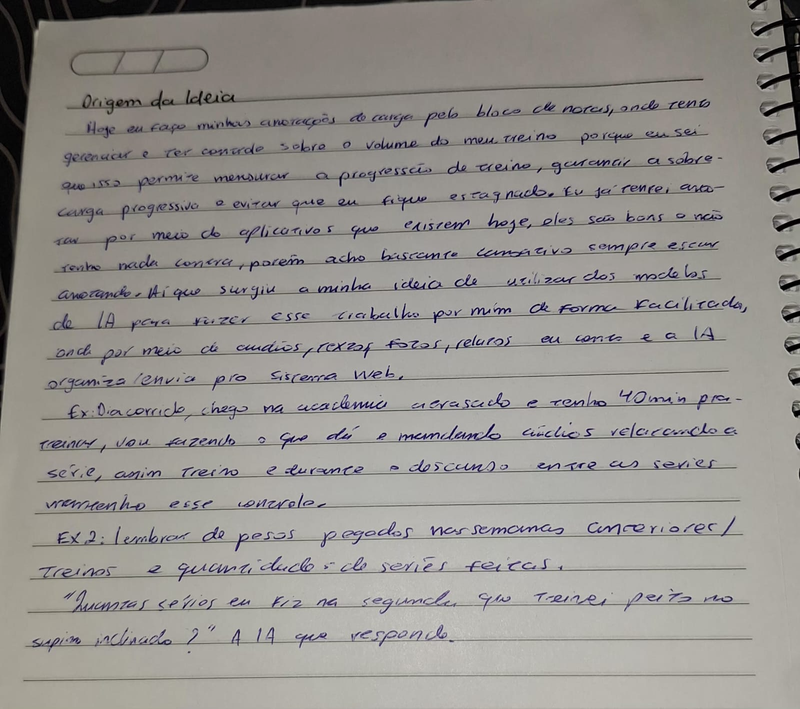

# Origem da ideia

## Em uma frase
Atlas é um assistente de treino por chat: eu relato o treino e a IA organiza os dados e guarda o histórico.

## O relato original
Hoje eu faço minhas anotações de carga pelo bloco de notas, onde tento gerenciar e ter controle sobre o volume do meu treino, porque eu sei que isso permite mensurar a progressão de treino, garantir a sobrecarga progressiva e evitar que eu fique estagnado. Eu já tentei anotar por meio de aplicativos que existem hoje; eles são bons e não tenho nada contra, porém acho bastante cansativo sempre escrever anotando. Aí surgiu a minha ideia de utilizar modelos de IA para fazer esse trabalho por mim de forma facilitada: por meio de áudios, textos, fotos e relatos, eu conto e a IA organiza e envia para o sistema web.

**Exemplo 1:** dia corrido, chego na academia atrasado e tenho 40 min para treinar. Vou fazendo o que dá e mandando áudios relatando a série; assim treino e, durante o descanso entre as séries, mantenho esse controle.

**Exemplo 2:** lembrar dos pesos pegados nas semanas anteriores, dos treinos e da quantidade de séries feitas. "Quantas séries eu fiz na segunda que treinei peito no supino inclinado?" A IA responde.

Registro original, escrito à mão no caderno:

## Contexto: de onde parto
Esta é a visão do produto completo. O MVP será um recorte dela, definido depois da pesquisa com outros praticantes.

Eu já tinha um pré-MVP pronto (o código está em [assistente-treino](https://github.com/vitorrodrigues-dev/assistente-treino)). Só que acreditei que bastava codar, sem antes planejar como o sistema seria construído, e deleguei partes demais do trabalho. Resultado: me perdi dentro do meu próprio projeto. Não sabia dizer o que o MVP fazia, quais eram os seus limites nem em que etapa eu estava.

Estou recomeçando da forma correta, seguindo o ciclo de projeto estudado na faculdade: planejamento, projeto, construção, validação, entrega e sustentação. Esta pasta documenta a fase de planejamento, e o código antigo será aproveitado onde servir. Prefiro deixar o erro registrado a escondê-lo, porque o aprendizado também faz parte do projeto.