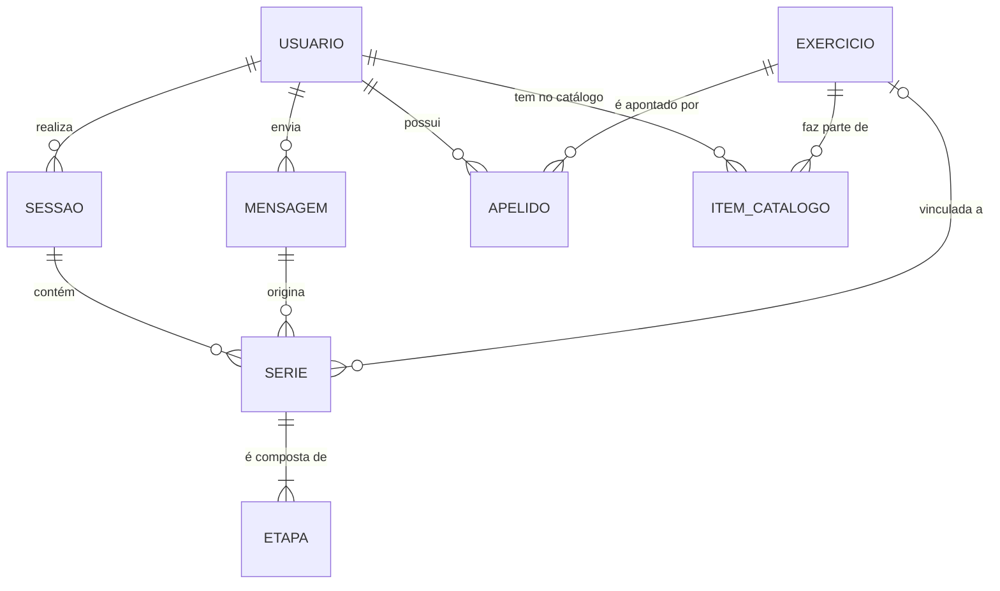

# Modelo de dados (lógico)

Fase 2 (Projeto). **Versão fechada em 07/11/2026, redigida com assistência de IA (Claude).** Todas as pendências do modelo foram decididas, por delegação do autor, com um critério: o testador faz o mínimo de esforço. Pela regra da Fase 2, o autor lê e veta antes de commitar. **Aceito pelo autor em 07/11/2026; ajustado em 08/11/2026 pela revisão de consistência** (D14 a D21). Documento vivo.

Fontes: `01-definicoes-de-dominio.md` (27/10), `04-ciclo-de-vida-do-registro.md` e `05-casos-de-uso.md` (01/11), `03-user-stories.md` e, como fonte de aprendizado, o `progresso.md` do repositório antigo. Quando o contexto de 28/10 e os casos de uso de 01/11 divergem, valem os casos de uso.

## O que este documento é (e não é)

- É o modelo **lógico**: entidades, atributos, relacionamentos, regras de integridade e limites, em termos do domínio.
- **Não escolhe banco, não tem tipo de SGBD e não tem DDL.** O modelo físico (tipos, índices, chaves) vem depois da escolha de tecnologias.
- Tipos lógicos: texto, inteiro, decimal, data, data-hora, sim/não, lista de valores.
- **Vazio** = nulo = "não dito". Nunca 0, nunca suposição (RNF-01).
- Obrigatório: **S** ou **n**. `[D#]` aponta para uma decisão (seção 6). `[R#]` aponta para uma regra (seção 4).

## 1. Diagrama

Leitura: o **usuário** envia **mensagens**; um relato vira **séries** dentro de uma **sessão**; cada série tem uma ou mais **etapas** (uma só, salvo no drop set), onde moram carga e repetições; a série aponta, se possível, para um **exercício** do catálogo do usuário.

## 2. Entidades

### USUARIO
Quem fala com o bot: testador ou administrador. Cadastro mínimo (decisão 5 de 28/10).

| Atributo | Obrig. | Regra |
|---|---|---|
| identificador | S | interno |
| id_canal | S | identificador da pessoa no canal (Telegram). Único |
| nome | S | o que o canal informa (`first_name`). Máx. 100 caracteres |
| status | S | PENDENTE, ATIVO ou BLOQUEADO |
| eh_administrador | S | sim/não. Quem recebe os avisos do UC-06; o autor fica fora das métricas `[D10]` |
| criado_em | S | data-hora do `/start` |
| aviso_enviado_em | n | data-hora em que a boas-vindas com o aviso de dados foi enviada (US-11). Prova de que o aviso foi mostrado, sem pedir nada ao testador `[D13]` |
| aprovado_em | n | preenchido ao virar ATIVO. Base da métrica "primeira semana" |

Transições: PENDENTE → ATIVO (UC-07, administrador); ATIVO ↔ BLOQUEADO (direto no banco, sem story). O primeiro administrador nasce por script, já ATIVO e com `eh_administrador` = sim (A15 de `07-arquitetura.md`). Nunca se guarda o texto de quem não está ATIVO.

### MENSAGEM
Toda mensagem de **texto** de um usuário ATIVO, na conversa privada, guardada crua (RNF-02, ciclo §1). É o que protege contra perda e duplicação.

| Atributo | Obrig. | Regra |
|---|---|---|
| identificador | S | interno |
| usuario | S | dono |
| id_canal | S | identificador da mensagem no canal. **Único por usuário** `[R1]` |
| enviada_em | S | data-hora de envio informada pelo canal, não a do processamento (reprocessar depois de uma queda não muda o dia) |
| texto_bruto | S | exatamente o recebido. Até 4096 caracteres (o limite do canal) |
| tipo | S | RELATO, CONSULTA ou COMANDO |
| comando | n | nome do comando, sem barra (`carga`, `evolucao`, `desfazer`). Permite contar o uso do `/evolucao` (H3) |
| resultado | n | **só em RELATO**: RECEBIDO, REGISTRADO, SEM_SERIES ou NAO_REGISTRADO `[D7]`. Relato fora do assunto (xingamento, dieta ou medicação, emergência) = SEM_SERIES, sem sessão nem observação; dor ou lesão registra normalmente e só dispara a resposta do RT-01 |
| motivo | n | só com NAO_REGISTRADO: EXTRACAO_FALHOU, VALIDACAO_RECUSOU, OBSERVACAO_CHEIA ou ERRO_INTERNO `[D19]`. **Código, nunca texto** (RNF-03) |
| desfeita_em | n | data-hora do desfazer. Só em RELATO com resultado REGISTRADO `[R9, D6]` |
| reprocessado_em | n | data-hora em que a subida do serviço começou a reprocessar o relato, gravada antes da chamada externa. Só em RELATO `[R18, D19]` |
| versao_extrator | n | versão do prompt e do modelo que interpretaram o relato `[D11]` |

### SESSAO
O treino realizado numa data. **Pode haver mais de uma por usuário e data** (decisão de 27/10).

| Atributo | Obrig. | Regra |
|---|---|---|
| identificador | S | interno |
| usuario | S | dono |
| data | S | data de envio da mensagem que a criou, em America/Sao_Paulo. Treino que cruza a meia-noite e "ontem" são limitações conhecidas |
| criada_em | S | desempata sessões do mesmo dia. A **sessão padrão do dia é a mais recente** |
| rotulo | n | etiqueta de texto ("treino A"), até 50 caracteres. O sistema não deduz nada dela |
| observacao | n | texto concatenado da sessão, até 1000 caracteres. **Não é desfeito** e não sabe de qual mensagem veio (ciclo §4) |

### EXERCICIO
Variação concreta do exercício, **compartilhada entre usuários** `[D5]`.

| Atributo | Obrig. | Regra |
|---|---|---|
| identificador | S | interno |
| nome_oficial | S | ex.: "Supino inclinado halter". Até 100 caracteres. Único |
| tipo_registro | S | PESO_E_REPS, CORPORAL, CORPORAL_COM_LASTRO, ASSISTIDO ou DURACAO. Diz o que a carga e as medidas **significam** `[D9]` |
| forma_carga_padrao | S | POR_LADO ou TOTAL. É a forma em que a carga é normalizada |

Atributos descritivos (movimento-base, equipamento, pegada, ângulo, lateralidade, grupo de variação) e a faixa-alvo de repetições **ficam fora do MVP**: nenhum caso de uso os consome `[D5]`.

### ITEM_CATALOGO
O catálogo de um usuário, montado a partir da ficha que ele envia (decisão 4 de 28/10). É só o vínculo.

| Atributo | Obrig. | Regra |
|---|---|---|
| usuario | S | |
| exercicio | S | |

Único por (usuario, exercicio) `[R3]`.

### APELIDO
Pertence ao usuário e aponta para **um único** exercício.

| Atributo | Obrig. | Regra |
|---|---|---|
| identificador | S | interno |
| usuario | S | |
| texto | S | em minúsculas, até 100 caracteres, igual a `exercicio_relatado` `[D14]`. Único por usuário `[R2]` |
| exercicio | S | tem de estar no catálogo do mesmo usuário `[R4]` |
| criado_em | S | |

Nome ambíguo nunca vira apelido (UC-02 2a, UC-10 1a).

### SERIE
Grupo de repetições de um exercício, numa sessão, originado por uma mensagem.

| Atributo | Obrig. | Regra |
|---|---|---|
| identificador | S | interno |
| sessao | S | |
| mensagem | S | a mensagem de RELATO que a criou. **É por ela que a série fica desfeita** `[D6]` |
| numero | S | de 1 a 99. Número da série no relato, **informativo, não único** (a série "2ª" corrigida pode repetir número). A ordem de leitura é (envio da mensagem, número). Se o interpretador não devolve o número, o código numera na ordem em que as séries aparecem no relato, por exercício, começando em 1 `[D20]` |
| exercicio_relatado | n | como o usuário disse, até 100 caracteres. **Vazio** quando ele não citou exercício (UC-01 6c) |
| exercicio | n | exercício oficial. Vazio = **pendente de vínculo**. Se `exercicio_relatado` está vazio e `exercicio` está preenchido, o exercício foi assumido pelo contexto (UC-01 6c) |
| motivo_pendencia | n | NAO_CATALOGADO, AMBIGUO ou SEM_EXERCICIO. Preenchido quando a série nasce pendente. **Só NAO_CATALOGADO cria apelido ao vincular** (UC-02 2a) |
| tipo | S | TRABALHO (padrão), AQUECIMENTO ou PREPARATORIA. Só se o usuário disse a palavra |
| falha | n | sim, não ou vazio. **Só preenchido quando dito** |
| texto_livre | n | o que o usuário disse sobre a série e o sistema não estrutura, até 500 caracteres. Trata-se como o texto bruto `[D2]` |

### ETAPA
Onde moram carga e repetições. **Toda série tem pelo menos uma etapa**; só o drop set tem mais de uma (no máximo 10) `[D3]`.

| Atributo | Obrig. | Regra |
|---|---|---|
| serie | S | |
| ordem | S | 1 para a série comum. Única por série. Ordem em que o usuário disse |
| carga_texto | n | a carga como foi escrita (prova), até 50 caracteres |
| carga_valor_informado | n | vazio = não dito. Zero só se dito (barra fixa sem peso). De 0 a 999,99, até 2 casas decimais; fora disso é recusado, nunca arredondado |
| carga_unidade_informada | n | KG, LB, PLACA ou PINO. **Vazio com valor presente = KG assumido** `[D12]` |
| carga_aproximada | n | sim/não. **Só existe se há valor informado** `[R8]` |
| carga_forma_declarada | n | POR_LADO, TOTAL ou vazio (não declarada) |
| carga_valor_normalizado | n | na `forma_carga_padrao` do exercício. LB vira KG; PLACA e PINO ficam como estão. Vazio se não der para calcular (inclui exercício pendente) |
| carga_origem | n | EXPLICITA, DERIVADA (40 total → 20 por lado) ou PADRAO_DO_EXERCICIO. **Preenchida se e só se há valor normalizado** `[R10]` |
| repeticoes_min | n | de 1 a 200. Vazio = não dito (nunca 0) `[D4]` |
| repeticoes_max | n | igual a `repeticoes_min` quando o usuário disse um número só; maior numa faixa ("6 a 8") |
| repeticoes_aproximadas | n | sim/não. Só existe se há repetições |
| duracao_segundos | n | de 1 a 3600. Para `tipo_registro` DURACAO `[D9]` |

## 3. Listas de valores

| Lista | Valores |
|---|---|
| usuario.status | PENDENTE, ATIVO, BLOQUEADO |
| mensagem.tipo | RELATO, CONSULTA, COMANDO |
| mensagem.resultado | RECEBIDO, REGISTRADO, SEM_SERIES, NAO_REGISTRADO |
| mensagem.motivo | EXTRACAO_FALHOU, VALIDACAO_RECUSOU, OBSERVACAO_CHEIA, ERRO_INTERNO |
| exercicio.tipo_registro | PESO_E_REPS, CORPORAL, CORPORAL_COM_LASTRO, ASSISTIDO, DURACAO |
| exercicio.forma_carga_padrao / etapa.carga_forma_declarada | POR_LADO, TOTAL |
| serie.tipo | TRABALHO, AQUECIMENTO, PREPARATORIA |
| serie.motivo_pendencia | NAO_CATALOGADO, AMBIGUO, SEM_EXERCICIO |
| etapa.carga_unidade_informada | KG, LB, PLACA, PINO |
| etapa.carga_origem | EXPLICITA, DERIVADA, PADRAO_DO_EXERCICIO |

DESFEITO **não** é valor de `resultado`: é a coluna `desfeita_em`, para preservar o que o relato foi antes de ser desfeito.

## 4. Regras de integridade

| # | Regra | Origem |
|---|---|---|
| R1 | (usuario, id_canal) é único em MENSAGEM: reentrega do canal é ignorada. `id_canal` sozinho não serve, só é único dentro do chat | RNF-02, repositório antigo |
| R2 | (usuario, texto) é único em APELIDO; texto em minúsculas | definições |
| R3 | (usuario, exercicio) é único em ITEM_CATALOGO | definições |
| R4 | O exercício de uma série ou de um apelido tem de estar no catálogo do usuário dono | UC-02, RNF-03 |
| R5 | O dono da sessão e o dono da mensagem de uma série são o mesmo usuário | RNF-03 |
| R6 | A mensagem que origina uma série é do tipo RELATO | UC-01 |
| R7 | (serie, ordem) é único em ETAPA; toda série tem ao menos uma etapa (regra de aplicação) | decisão do drop set |
| R8 | `carga_aproximada` só existe com valor informado; `repeticoes_aproximadas` só com repetições | repositório antigo |
| R9 | `desfeita_em` só em RELATO com resultado REGISTRADO. Observação não é desfeita | UC-03, ciclo §4 |
| R10 | `carga_origem` está preenchida se e só se `carga_valor_normalizado` está | definições |
| R11 | Carga nunca negativa: assistência é `tipo_registro`, não carga negativa | definições |
| R12 | `resultado = REGISTRADO` implica ao menos uma série; SEM_SERIES implica nenhuma | UC-01 4b |
| R13 | `repeticoes_min` ≤ `repeticoes_max`; as duas vazias ou as duas preenchidas | D4 |
| R14 | **Exclusão do histórico:** apaga etapas, séries, sessões e mensagens (inclusive desfeitas e consultas) do usuário. Cadastro, catálogo e apelidos ficam | UC-09, `[D2]` |
| R15 | **Exclusão total:** apaga também apelidos, catálogo e cadastro. **Exercícios compartilhados ficam sempre** | UC-09, `[D2]` |
| R16 | Valor fora dos limites da seção 2, ou texto maior que o limite, é **recusado**, nunca truncado nem arredondado (a mensagem inteira vira NAO_REGISTRADO, motivo VALIDACAO_RECUSOU) | ciclo §4, UC-01 4a |
| R17 | PLACA e PINO só valem se o usuário disse; a unidade nunca é assumida como PLACA ou PINO | `[D12]` |
| R18 | `reprocessado_em` só existe em RELATO | `[D19]` |

Os limites da seção 2 são do MVP e podem ser revistos depois da primeira semana de teste. No modelo físico viram tamanhos de coluna e restrições de intervalo.

## 5. O que cada caso de uso lê e grava

| UC | Grava | Lê |
|---|---|---|
| UC-01 | MENSAGEM (resultado, motivo; relato fora do assunto = SEM_SERIES, sem sessão; `reprocessado_em` na subida `[D19]`), SESSAO, SERIE, ETAPA | USUARIO, ITEM_CATALOGO, APELIDO, EXERCICIO; contexto de 30 min = séries recentes do usuário pelo `enviada_em`, sem relato desfeito nem NAO_REGISTRADO (não é armazenado) `[D21]` |
| UC-02 | SERIE.exercicio de todas as séries pendentes da mesma mensagem com o mesmo `exercicio_relatado`, na mesma transação; APELIDO (só NAO_CATALOGADO, uma vez, se ainda não existe) `[D14]` | MENSAGEM.desfeita_em (via série), ITEM_CATALOGO, APELIDO |
| UC-03 | MENSAGEM (COMANDO `desfazer`, quando vem pelo comando), MENSAGEM.desfeita_em | MENSAGEM (24 h, REGISTRADO, não desfeita) |
| UC-04 | MENSAGEM (CONSULTA) | SESSAO, SERIE, ETAPA, EXERCICIO, APELIDO, desfeita via mensagem |
| UC-05 | MENSAGEM (CONSULTA, `evolucao`) | como o UC-04, séries TRABALHO `[D1]` |
| UC-06 | USUARIO (PENDENTE, aviso_enviado_em) | USUARIO |
| UC-07 | MENSAGEM (COMANDO `aprovar`), USUARIO.status, aprovado_em | USUARIO |
| UC-09 | exclusão do histórico ou total `[R14, R15]` | tudo do usuário |
| UC-10 | EXERCICIO, ITEM_CATALOGO, APELIDO | EXERCICIO |

Como o UC-09 e o UC-10 são do administrador e o banco está dentro da fronteira, as regras R4, R14 e R15 valem também para o script dele.

## 6. Decisões

Critério usado em todas: **o testador não faz nada a mais**. Onde havia duas saídas, ficou a que não pede toque, pergunta ou reaprovação.

### Fechadas a partir dos pontos abertos dos casos de uso

**D1. Evolução (UC-05, 4a).** Para cada **sessão**, a **maior `carga_valor_normalizado`** entre as séries TRABALHO não desfeitas do exercício, olhando a etapa 1 de cada série, mais as repetições da série em que ocorreu (a maior, se houver empate). "Registro" no mínimo de 3 = sessão com ao menos uma série de trabalho com carga normalizada. Séries sem carga normalizada ficam fora. Se o exercício tem cargas em unidades incomparáveis (kg e placa), o comando mostra só a unidade mais recente e avisa, sem perguntar nada. Por quê: a maior carga do dia é o que se compara na progressão; a média mistura séries diferentes e a última série sofre fadiga e drop set. Alternativas descartadas: média, última série. **Emenda D17 (decidido em 08/11/2026 por delegação do autor):** vale só para PESO_E_REPS e CORPORAL_COM_LASTRO; o mínimo de 3 conta só as sessões na unidade mostrada.

**D2. Exclusão e retenção (UC-09, ciclo §6).**
- **Pedido:** por mensagem ao administrador, no mesmo canal de fora do bot em que ele já confirma quem é a pessoa (UC-07, passo 1). O testador não preenche formulário.
- **Padrão = exclusão do histórico `[R14]`:** o testador continua ATIVO, com o catálogo e os apelidos, e não precisa pedir aprovação de novo. Se ele pedir para **sair**, vale a exclusão total `[R15]`; para voltar, novo `/start` e nova aprovação.
- **Prazo no MVP:** 7 dias corridos. Decisão operacional, não parecer jurídico.
- **Backup:** cópias guardadas por no máximo 30 dias e depois descartadas. O administrador mantém um registro privado das exclusões (data, tipo e identificador interno, sem nome nem texto) e, se um dia restaurar um backup, refaz as exclusões listadas.
- **`texto_livre`** segue o texto bruto: sai na exclusão e na revisão de retenção antes de abrir além dos testadores (basta anular a coluna, sem mudar o modelo). Fecha o ponto 4 do ciclo §6.

**D8. Nenhuma candidata serve (UC-02, 1c).** A série continua pendente e o testador não precisa fazer nada. O botão só vincula enquanto a série está pendente. O administrador acrescenta o exercício ao catálogo pelo UC-10; a série pendente não é vinculada depois: o testador usa Desfazer e reenvia (**emenda D16, decidido em 08/11/2026 por delegação do autor**). **Não há correção de vínculo no MVP:** vínculo errado se corrige com o botão **Desfazer** (um toque) e reenvio. Corrigir vínculo pediria mais um fluxo e mais um estado, e o teste ainda não mostrou que acontece.

**D12. Unidade não dita e exibição da carga.**
- Sem unidade, lê-se **KG**, como o "NxM" é lido na convenção (decisão de 27/10). A confirmação mostra "kg" e o `/desfazer` corrige. Isso evita deixar vazia a carga normalizada da maioria dos relatos reais. Não precisa de coluna: unidade informada vazia com valor presente significa KG assumido. PLACA e PINO nunca são assumidos `[R17]`.
- **Exceção deliberada ao RNF-01** ("nunca inventa o que não falei"): o dado guardado continua honesto (unidade vazia), mas o valor normalizado nasce de uma suposição. **Aceita pelo autor em 07/11/2026.** A alternativa recusada era deixar a carga normalizada vazia quando a unidade não é dita; a evolução perderia a maioria dos relatos.
- `/carga` mostra a carga **como o usuário disse** (valor, forma declarada, `~`), não a normalizada, e sem unidade quando ela não foi dita; só a confirmação do relato mostra "kg" (**emenda D21, decidido em 08/11/2026 por delegação do autor**). O `/evolucao` usa a normalizada. Assim o testador vê o que digitou.

### Escolhas de desenho

| # | Escolha | Por quê | Alternativa descartada |
|---|---|---|---|
| D3 | Carga e repetições ficam na **ETAPA**; série comum = 1 etapa, drop set = N | Uma só forma de ler, validar e normalizar; sem caso especial para o drop set | Campos na série e tabela de etapas só no drop set: mais direta no caso comum, mas duplica a estrutura |
| D4 | Repetições como **faixa** (mín, máx) | "6 a 8" guardado como "~6" inventa um número e perde o 8 (RNF-01; o repositório antigo errou com "~42,5 × ~7") | Só o menor valor com `~` |
| D5 | **Exercício compartilhado** + ITEM_CATALOGO por usuário; atributos descritivos e faixa-alvo fora do MVP; grupamento também sai (emenda D18, 08/11/2026) | O UC-10 2a já pressupõe reutilizar exercício; exercício não tem dado pessoal, então excluir usuário não o apaga. Nenhum UC usa os atributos descritivos | Exercício próprio de cada usuário: duplicação e nenhum reuso |
| D6 | **Desfeito só na mensagem**; séries herdam. Comandos também são guardados como mensagem | Desfazer é um UPDATE só e atômico; a chave única R1 torna o `/desfazer` idempotente sem coluna extra (o repositório antigo precisou de uma) | Marcar mensagem e séries: duas escritas que podem divergir |
| D7 | `resultado` guardado (4 valores) e `desfeita_em` separado | NAO_REGISTRADO e SEM_SERIES não se distinguem por dedução; um RECEBIDO antigo revela relato interrompido | Derivar o estado das séries; perde a falha e o motivo |
| D9 | **Assistência** é a carga lida pelo `tipo_registro` ASSISTIDO (nunca negativa); **duração** é campo próprio da etapa | Resolve "onde ficam duração e assistência" sem entidade nova | Entidades separadas |
| D10 | `eh_administrador` e `aprovado_em` em USUARIO | O autor não conta nas métricas; "primeira semana" precisa de uma data de início por testador | Ler o administrador de configuração |
| D11 | `versao_extrator` na mensagem | O prompt v4 vai mudar durante o teste; sem a versão não se compara a taxa de `/desfazer` antes e depois | Sem a coluna |
| D13 | `aviso_enviado_em` em USUARIO | Registra que o aviso de dados foi enviado, sem pedir clique nem "aceito" ao testador. Fecha o ponto de consentimento do modelo | Pedir confirmação explícita (atrito; decidir na US-11 se a revisão de LGPD exigir) |

### Revisão de consistência (decidido em 08/11/2026 por delegação do autor)

Critério: testador e administrador fazem o mínimo de esforço; menos peças.

**D14. Vínculo por mensagem e texto (UC-02).** O botão de candidata vale para **todas** as séries pendentes da **mesma mensagem** com o mesmo `exercicio_relatado`: um toque liga todas, na mesma transação. Apelido: só se `motivo_pendencia` = NAO_CATALOGADO e o texto não está vazio, criado uma vez. Se já existe apelido com esse texto (R2), não cria nem altera; só vincula. Séries de outras mensagens não são afetadas (as próximas casam pelo apelido). `APELIDO.texto` passa de 50 para até 100 caracteres, igual a `exercicio_relatado`. Por quê: "3x10" de um exercício não catalogado gera três séries com o mesmo texto; vincular uma por uma pediria três toques e tentaria criar o mesmo apelido três vezes.

**D15. Candidatas dos botões (UC-01 6a, 6b e 6c).** Até 5 botões. Origem: exercícios do catálogo do usuário que compartilham ao menos uma palavra com o texto dito (minúsculas, sem acento), ordenados pelo número de palavras em comum (maior primeiro) e depois pelo nome oficial. No caso 6b (nome ambíguo), usa as candidatas que o casamento achou, com o mesmo limite. Caso 6a sem nenhuma candidata: série pendente, sem botões; a confirmação diz "Não reconheci: <texto>". Caso 6c sem exercício dentro da janela de 30 minutos: série pendente com motivo SEM_EXERCICIO, sem botões; a confirmação pede para reenviar com o nome do exercício ou usar Desfazer. O botão leva só identificadores numéricos (o canal limita o dado do botão a 64 bytes). O casamento é função do Domínio (`07-arquitetura.md`, seção 4).

**D16. Sem vínculo retroativo (UC-02 1c; emenda ao D8).** Quando nenhuma candidata serve, a série continua pendente; o testador usa Desfazer e reenvia depois que o administrador cadastrar o exercício (UC-10). Depois de 24 horas o Desfazer vence; o testador só reenvia; a série pendente antiga fica fora das leituras e o reenvio conta como outro relato nas métricas (limite aceito). Não há script nem fluxo de vínculo retroativo no MVP: série pendente nunca vinculada fica fora de `/carga` e `/evolucao`. Vínculo errado depois de 24 horas não tem correção (aceito).

**D17. Evolução por tipo de registro (UC-05; emenda ao D1).** `/evolucao` só atende exercícios PESO_E_REPS e CORPORAL_COM_LASTRO. Para ASSISTIDO, CORPORAL e DURACAO responde "ainda não acompanho a evolução desse tipo de exercício". `/carga` vale para todos os tipos. O mínimo de 3 sessões conta só as sessões na unidade mostrada. A resposta é por sessão, com a data. Por quê: em ASSISTIDO a maior carga é a maior assistência (pior desempenho), e CORPORAL e DURACAO não têm carga.

**D18. Grupamento sai do MVP (UC-10; emenda ao D5).** Sai `EXERCICIO.grupamento`: só a US-05 (pós-MVP) usaria. O passo 1 do UC-10 passa a conferir nome oficial, `tipo_registro` e forma da carga.

**D19. Reprocessamento e falha interna (emenda ao A12 de `07-arquitetura.md`).** Novo atributo `MENSAGEM.reprocessado_em` (data-hora, vazio por padrão, só em RELATO, R18). Novo motivo ERRO_INTERNO: falha na T2 que não é validação, ou relato que continua RECEBIDO depois do reprocessamento. Na subida do serviço: RECEBIDO com `reprocessado_em` vazio → grava `reprocessado_em` numa transação curta **antes** da chamada externa e reprocessa; RECEBIDO com `reprocessado_em` preenchido → NAO_REGISTRADO, motivo ERRO_INTERNO, e o usuário recebe o aviso de reenviar. Isso impede o laço de queda: um relato que derruba o serviço é tentado uma vez só. `motivo` passa a ter 4 valores.

**D20. Número da série.** Se o interpretador não devolve o número, o código numera na ordem em que as séries aparecem no relato, por exercício, começando em 1. É ordinal de leitura, informativo, não uma afirmação do que foi dito (RNF-01 inalterado).

**D21. Ajustes pequenos.** (a) `/carga` mostra a carga como dita, sem unidade quando ela não foi dita; a confirmação do relato mostra "kg" (D12). (b) A janela de 30 minutos conta pelo `enviada_em` da mensagem; relato desfeito ou NAO_REGISTRADO não conta como "último exercício citado". (c) Vínculo errado depois de 24 horas: aceito (D16).

## 7. Conflitos encontrados e como foram resolvidos

| Conflito | Solução |
|---|---|
| `exercicio_relatado` obrigatório nas definições × UC-01 6c ("2ª série, 55kg" não cita exercício) | Opcional; vazio = o usuário não citou exercício |
| "Número da série por exercício" × série pendente (sem exercício oficial) | O número é informativo e não único; a ordem vem da mensagem |
| Unidade não dita (nenhum documento cobria) | KG assumido, mostrado na confirmação `[D12]`. **Conflita com o RNF-01**; exceção aceita pelo autor em 07/11/2026 |
| US-02 diz "o bot pergunta em vez de assumir" × decisão 2 (grava pendente e oferece botões) | Vale a decisão 2; story ajustada em 07/11/2026 |
| Ciclo de vida lista DESFEITO como estado do relato | No modelo é `desfeita_em`, não um valor de `resultado`; o comportamento é o mesmo |
| Peso da barra e da plataforma | Não entra no MVP: a normalização é na forma padrão do exercício (por lado, no supino com barra), então não há cálculo de total |
| "Registros" no mínimo de 3 (UC-05): séries ou sessões? | Sessões com carga de trabalho normalizada `[D1]` |
| Texto livre da série segue a série ou o texto bruto? (ciclo §6.4) | Segue o texto bruto `[D2]` |
| Escopo e "Campos da série" ainda dizem carga e repetições na série | Ajuste listado na seção 9 |

## 8. Fora do modelo

- Atributos descritivos do exercício, faixa-alvo, grupo de variação, grupamento (D18), ficha como entidade, modalidade e abertura além dos testadores: fora do MVP.
- Modelo físico: tipos, índices e chaves, depois da escolha de tecnologias.
- Revisão de LGPD e do aviso de dados antes de abrir além dos testadores (não é parecer jurídico).

## 9. Ajustes nos outros documentos

- `01-definicoes-de-dominio.md`: tabela "Campos da série" (carga e repetições passam à etapa, repetições em faixa, `exercicio_relatado` opcional, unidade assumida), atributos do exercício fora do MVP.
- `05-casos-de-uso.md`: fechar UC-05 4a (D1), UC-02 1c (D8), "registros" do mínimo de 3, UC-09 (D2: pedido, prazo, backup, cadastro).
- `04-ciclo-de-vida-do-registro.md`: pontos abertos 1, 4 e 5 fechados.
- `05-escopo-do-mvp.md`: remover "botões para confirmar" (US-03) e a janela de contexto da lista de pendências (30 minutos).
- `00-roteiro.md`: marcar "Modelo de dados" depois que o autor ler e aceitar.
