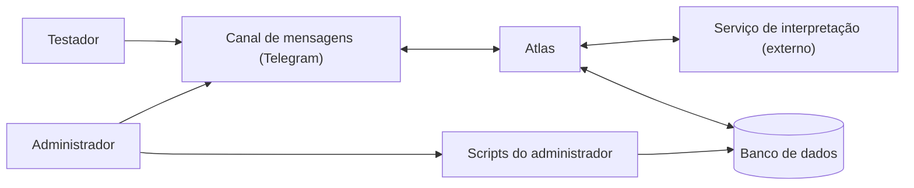
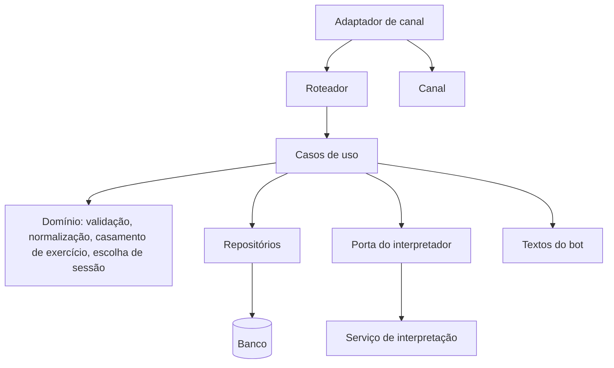
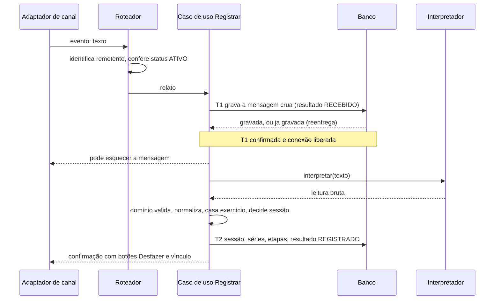

# Arquitetura (lógica)

Fase 2 (Projeto). **Redigido em 07/11/2026 com assistência de IA (Claude). Aceito pelo autor em 07/11/2026.** Documento vivo.

Fontes: `06-modelo-de-dados.md`, `05-casos-de-uso.md`, `04-ciclo-de-vida-do-registro.md`, `03-user-stories.md` (RNF-01 a 05) e, como fonte de aprendizado, o `progresso.md` do repositório antigo (marcado **[v1]** onde uma decisão vem de um erro ou acerto de lá).

## 1. O que este documento é (e não é)

- É a arquitetura **lógica**: blocos, responsabilidades, fronteiras, fluxos e regras que valem entre os blocos.
- **Não escolhe linguagem, framework, banco, hospedagem nem modelo de IA.** Isso é a etapa seguinte, e este documento diz o que ela precisa atender (seção 8).
- Herdadas e tratadas como hipótese até a etapa de tecnologias: canal Telegram, serviço de interpretação por modelo de linguagem, banco relacional.
- Não define pacotes, classes nem tabelas físicas. Isso é construção.

## 2. Direcionadores

O que a arquitetura precisa garantir, e onde cada exigência vira decisão.

| Origem | Exigência | Decisões |
|---|---|---|
| RNF-01 Confiar no histórico | O que não foi dito fica vazio; o modelo de linguagem nunca decide o dado final | A4, A5 |
| RNF-02 Não perder nem duplicar | Texto salvo antes de qualquer chamada externa; reentrega sem duplicar | A1, A2, A3, A12 |
| RNF-03 Privacidade e segurança | Isolamento por usuário; nada de conteúdo no log; segredos fora do código | A6, A13 |
| RNF-04 Orçamento | Uma chamada ao serviço de interpretação por relato, nunca por comando | A5, A11 |
| RNF-05 Resposta rápida | Consultas sem chamada externa; tempo medido no teste | A5, A14 |
| US-09, RT-01 Tom e limites | Todas as frases são do sistema; o texto de emergência é fixo | A4, A10 |
| Um desenvolvedor, ~15 testadores | Poucas peças, camadas legíveis, sem abstração antecipada | A8, A9 |
| Evolução futura | Trocar o canal (WhatsApp) e o interpretador sem mexer nas regras | A9 |

## 3. Contexto

O banco está dentro da fronteira do sistema e os scripts do administrador são a interface dele com o banco (decisão de 01/11). O canal e o serviço de interpretação são externos e não confiáveis: podem falhar, repetir ou demorar.

## 4. Componentes

| Componente | Responsabilidade | Não faz |
|---|---|---|
| **Adaptador de canal** | Recebe do canal e entrega ao Roteador um **evento canônico** (texto, comando, toque de botão, edição, mídia). Envia respostas. Conhece a mecânica de entrega do canal e a confirmação de recebimento | Regra de negócio. Não sabe o que é uma série |
| **Roteador** | Identifica o remetente, aplica o **portão de status** (A16) e decide o destino: silêncio, caso de uso ou aviso | Gravar dados de treino |
| **Casos de uso** | Um por UC (UC-01 a UC-07). Orquestram: abrem e fecham transação, chamam repositórios, interpretador e domínio, escolhem a resposta | Regra de conversão (fica no domínio) |
| **Domínio** | Funções puras, sem entrada nem saída: valida limites (R16), expande "NxM" em séries, normaliza carga, casa o texto com exercício (apelido, nome oficial, todas as palavras), decide a sessão e a janela de contexto de 30 minutos | Banco, rede, relógio fixo |
| **Repositórios** | Leem e gravam as entidades do modelo. **Toda operação recebe o usuário** e filtra por ele (A6) | Controlar transação (A7) |
| **Porta do interpretador** | Uma operação: texto entra, leitura bruta sai (seção 6). Implementação real e implementação falsa para teste | Decidir dado final |
| **Textos do bot** | Todas as frases que o usuário lê, em um lugar só (A10) | Lógica |
| **Configuração** | Segredos e parâmetros lidos do ambiente; falha alto se faltar | Guardar segredo no código ou no repositório |

Fora do Atlas em tempo de execução, mas parte do sistema: **scripts do administrador** (UC-09 exclusão, UC-10 ficha, bloquear e desbloquear). Respeitam as regras R4, R14 e R15 do modelo.

## 5. Fluxos

### 5.1 UC-01 Registrar relato

Desvios, todos como **resultado**, não como exceção (A3):

- **Reentrega (1b):** T1 responde "já gravada"; silêncio.
- **T1 falha (2a):** nada foi salvo; o canal reentrega; conta para o teto de tentativas (A1).
- **Interpretador falha (3a):** mensagem vira NAO_REGISTRADO, motivo EXTRACAO_FALHOU; o texto fica salvo e o usuário recebe "salvei o texto, mas não consegui registrar; reenvie".
- **Validação recusa (4a):** NAO_REGISTRADO, motivo VALIDACAO_RECUSOU; nenhuma série é gravada (tudo ou nada).
- **Sem séries (4b):** SEM_SERIES, com observação cria ou atualiza a sessão.
- **Observação cheia:** NAO_REGISTRADO, motivo OBSERVACAO_CHEIA.
- **Queda entre T1 e T2:** a mensagem fica RECEBIDA; na subida do serviço é reprocessada (A12).

### 5.2 UC-03 Desfazer (comando ou botão)

Sem interpretador. O caso de uso localiza a mensagem alvo (a última válida de relato REGISTRADO nas últimas 24 horas para o comando; a da confirmação para o botão), grava `desfeita_em` em **uma** atualização e responde com o que saiu. O comando entra como MENSAGEM, então a reentrega do mesmo comando é barrada pela chave única (R1) e não desfaz um segundo registro. Toque duplo no botão: a segunda vez encontra a mensagem já desfeita e responde "já foi desfeito".

### 5.3 UC-02 Vincular exercício (botão)

Sem interpretador. Só vale se a série ainda está pendente e a mensagem de origem não foi desfeita. Liga a série ao exercício, **e só** cria apelido se `motivo_pendencia = NAO_CATALOGADO` e o texto relatado não está vazio, tudo na mesma transação. Série já vinculada: responde a qual exercício está ligada.

### 5.4 UC-04 e UC-05 Consultas

Sem interpretador. Gravam a consulta como MENSAGEM (CONSULTA, com o nome do comando), casam o exercício pelo domínio, leem via repositório filtrando por usuário e mensagens não desfeitas, e respondem. Resposta de `/carga` com o valor como dito; `/evolucao` com o valor normalizado (D1, D12).

### 5.5 UC-06 e UC-07 Entrada e aprovação

`/start` de pessoa desconhecida cria USUARIO PENDENTE **sem gravar o texto da mensagem**, envia a boas-vindas com o aviso de dados, registra `aviso_enviado_em` e avisa o administrador. `/aprovar <id>` só é aceito de usuário ATIVO com `eh_administrador`; de qualquer outro, a resposta é "comando não reconhecido".

## 6. Contrato do interpretador (conceitual)

O interpretador **só lê o que foi dito**. Toda conversão é feita em código determinístico (A4). A forma exata dos campos é do prompt (v4), mas a fronteira é esta:

| Entra | Sai (todos os campos opcionais, exceto onde indicado) |
|---|---|
| O texto bruto do relato | **Sessão:** pediu nova sessão (sim/não), rótulo, observação (aquecimento geral, humor do dia) |
| | **Séries:** exercício como dito, número dito, quantidade de séries quando dito como "NxM", tipo (só se a palavra foi dita), falha (só se dita), texto livre da série, etapas (carga como escrita, valor, unidade dita, aproximado, forma declarada, repetições mín e máx, aproximado, duração) |
| | **Fora do assunto:** categoria (xingamento, dor, dieta ou medicação, emergência) ou nenhuma. **Nunca** texto de resposta |

Regras do contrato:

- **O que não foi dito não aparece.** O modelo nunca preenche por suposição (RNF-01).
- **Campos obrigatórios que o modelo quebra falham alto** na validação (lição do repositório antigo, **[v1]**).
- O interpretador **não recebe o catálogo do usuário**. O casamento com o exercício oficial é do domínio, o que mantém o dado do usuário fora da chamada externa e o modelo fora da decisão.
- Texto sobre dor ou lesão vai para o `texto_livre` da série ou a observação, como no UC-01 6f. A categoria "dor" só dispara a resposta de RT-01 (sugerir um profissional), não impede o registro.

## 7. Decisões de arquitetura

Critério usado: poucas peças, o mínimo de esforço para o testador, nada que o autor não consiga explicar. **Origem** diz se a decisão vem de um erro ou acerto do repositório antigo **[v1]**, dos documentos do Atlas, ou se é nova.

### Entrega e consistência

| # | Decisão | Por quê | Origem |
|---|---|---|---|
| A1 | A entrega do canal é **pelo menos uma vez**. O canal só é liberado da mensagem **depois de T1** (texto cru gravado), ou de uma falha que repetir não resolve (recusa do banco, erro de programação). Falha de conexão **não libera**: o sistema espera e repete, com teto de 10 tentativas, porque a classificação do erro pode errar | A única cópia da mensagem está no canal até T1. Liberar antes é jogar o relato fora | **[v1]** |
| A2 | **Duas transações** em torno da chamada externa. A conexão com o banco **não fica aberta** durante a chamada ao interpretador | A chamada pode levar até um minuto; conexão presa em T1 esgota o banco e prende o rollback | **[v1]** |
| A3 | Falha depois de T1 é um **resultado** (NAO_REGISTRADO com motivo), nunca uma exceção que escapa | Se a falha fosse exceção, o canal reentregaria e a reentrega cairia em "já gravada", deixando a mensagem sem resposta para sempre | **[v1]** |
| A12 | Na subida do serviço, relatos **RECEBIDO** são reprocessados uma vez. Se falharem de novo, viram NAO_REGISTRADO com o motivo da falha e o testador recebe o aviso de reenviar | O testador não precisa reenviar depois de uma queda, e o reprocessamento é seguro porque T2 é tudo ou nada. Não exige coluna nem motivo novo | Nova |

### Interpretador

| # | Decisão | Por quê | Origem |
|---|---|---|---|
| A4 | O interpretador é **não confiável**: só extrai, nunca decide. NxM, normalização de carga, casamento de exercício, escolha de sessão e janela de contexto são **código determinístico**. **O modelo nunca escreve texto para o usuário**: todas as respostas vêm dos Textos do bot, a partir de dados e categorias | Mantém RNF-01 e garante o texto fixo de emergência do RT-01. Código determinístico se testa; resposta de modelo, não | Documentos |
| A5 | **Comandos e toques de botão nunca chamam o interpretador** | Custo, velocidade e resultado previsível (`/carga` com texto livre exigiria distinguir relato de consulta e erraria) | **[v1]** |
| A18 | O prompt e a **lista de mensagens de regressão** (incluindo os casos de RT-01) ficam versionados no repositório. Cada relato guarda `versao_extrator` | Prompt muda durante o teste; sem versão não se compara a taxa de `/desfazer` antes e depois | **[v1]**, modelo D11 |

### Estrutura

| # | Decisão | Por quê | Origem |
|---|---|---|---|
| A6 | **Isolamento por usuário nos repositórios**: toda operação recebe o usuário e o filtra, e a consulta de série filtra por usuário na sessão **e** na mensagem (R5) | O banco não impede a mensagem do usuário A de apontar para a sessão do B; a barreira precisa estar onde o dado é lido | **[v1]**, RNF-03 |
| A7 | A **transação pertence ao caso de uso**. Os repositórios recebem a conexão e não abrem a própria | Se cada repositório abrisse a sua, sessão e séries ficariam em transações diferentes e um erro deixaria metade gravada | **[v1]** |
| A8 | **Processamento serial**: um evento por vez, na ordem de chegada (relatos, comandos e toques) | A ordem importa (contexto de 30 minutos, sessão padrão do dia) e serial evita condição de corrida na criação da sessão. Para ~15 testadores a espera é de segundos | Nova |
| A9 | **Só duas portas**: Canal e Interpretador, cada uma com implementação real e falsa; relógio injetável. Repositórios são concretos, testados contra banco real | Só abstrai onde há duas implementações à vista (Telegram e WhatsApp; modelo real e falso). Abstração antecipada além disso vira código que o autor não domina | Documentos |
| A10 | **Todas as frases do bot em um módulo único de textos**, com o texto de emergência fixo. Texto ainda não revisado leva a marca PROVISÓRIO e o teste confere que nenhuma sobrou | US-09 pede revisão das frases antes do teste | **[v1]** |
| A16 | **Portão de status** (tabela abaixo) no Roteador, antes de qualquer caso de uso | Uma regra só decide quem é ouvido; nada de quem não está ATIVO é gravado | **[v1]**, UC-06 |

Portão de status:

| Remetente | `/start` | Outro texto, comando ou toque |
|---|---|---|
| Desconhecido | UC-06 (cria PENDENTE) | **Silêncio** |
| PENDENTE | "aguardando aprovação" e avisa o administrador de novo | **Silêncio** (lacuna dos casos de uso, decidida aqui) |
| ATIVO | "já cadastrado" | Segue para o caso de uso; `/aprovar` só se `eh_administrador` |
| BLOQUEADO | **Silêncio** | **Silêncio** |

### Operação

| # | Decisão | Por quê | Origem |
|---|---|---|---|
| A11 | **3 falhas seguidas** do interpretador avisam o administrador pelo canal, uma vez até voltar ao normal | Crédito acabado ou chave inválida fariam todo relato falhar sem ninguém perceber, e o teste ficaria distorcido | Nova |
| A13 | **Log só com código, classe e duração.** Nunca texto, nome, identificador de usuário nem token. Exceções de rede guardam só o nome da classe, porque a mensagem pode trazer a URL com o token. Início e parada do serviço ficam registrados | RNF-03; o escopo pede registrar os períodos fora do ar | **[v1]**, RNF-03 |
| A14 | **Sem tabela de métricas.** As métricas do teste saem de consultas ao banco (usuários aprovados e ativos por semana, relatos sem `desfeita_em`, uso de `/evolucao`) e do log (tempo de resposta, quedas). O custo vem do painel do provedor | Tudo que a métrica precisa já está no modelo; tabela nova seria dado duplicado | Nova |
| A15 | **Administração fora do bot**: ficha (UC-10), exclusão (UC-09) e bloquear são scripts no banco. O único comando do administrador no bot é `/aprovar` | Menos superfície de ataque e menos código; o administrador é um só | Documentos (decisão 4) |
| A17 | **Eventos não suportados:** edição de mensagem recebe aviso que ensina o Desfazer; foto, áudio e figurinha recebem "por enquanto só leio texto", **mesmo com legenda**, que não é lida como relato; mensagem em grupo é ignorada. **Nada é gravado** em nenhum desses casos | O testador não fica sem resposta, e dado que não é relato não entra no banco | **[v1]**, ciclo §1; legenda: autor, 07/11/2026 |

## 8. O que a arquitetura exige da etapa de tecnologias

Checklist que cada opção precisa cumprir. Nenhuma tecnologia está escolhida.

| # | Exigência | Vem de |
|---|---|---|
| 1 | Banco com **transações**, restrições de unicidade (R1 a R3, R7) e de intervalo (R16). Chave composta ou verificação equivalente para R4 e R5 | Modelo, A7 |
| 2 | Backup agendável e descarte de cópias com mais de 30 dias | D2 |
| 3 | Canal com entrega confirmável (A1) e botões em linha. O modo de entrega (consulta periódica ou chamada de volta) decide a hospedagem: chamada de volta exige endereço público com HTTPS | A1, UC-01 |
| 4 | Execução contínua de um processo, com reinício controlado e saída limpa. O custo de ficar fora do ar é aceito no teste (RNF-05) | Escopo |
| 5 | Segredos só em variáveis de ambiente e fora do repositório | RNF-03 |
| 6 | Serviço de interpretação com **saída estruturada**, modelo de versão fixa e temperatura 0, custo por chamada conhecido e crédito pré-pago sem recarga automática | RNF-01, RNF-04, A18 |
| 7 | Testes de integração contra o banco real e contra implementações falsas do canal e do interpretador | A9 |
| 8 | Linguagem e ferramentas que o autor consiga ler, explicar e manter sozinho | Objetivo do projeto |
| 9 | Local dos dados e do processamento compatível com o aviso da boas-vindas (o texto passa por API externa) | US-11, LGPD |

O **inventário de restrições** (banco, custo da API, hospedagem, tempo) é o próximo documento e fecha esta lista com números.

## 9. Riscos e limites conhecidos

- **Notebook fora do ar:** o serviço para; as mensagens esperam no canal. Aceito no teste e registrado como feedback (RNF-05). O canal só guarda mensagens por tempo limitado, então uma queda longa perde relatos; o tempo exato depende do canal e vira dado do inventário.
- **Classificação de RT-01 pelo modelo:** um falso negativo envia uma mensagem de emergência ao registro, que responde "não encontrei séries". Mitigação: lista de regressão de mensagens de RT-01 e texto fixo. Não elimina o risco; vale registrar no aviso de dados.
- **Processamento serial:** vários testadores relatando ao mesmo tempo esperam na fila; para ~15, aceito. Revisar com o tempo de resposta medido.
- **Confirmação acima do limite do canal:** relato com muitas séries pode gerar resposta maior que o canal aceita. Regra de arquitetura: o Textos do bot resume e avisa; o dado continua gravado.
- **Queda entre a gravação e a resposta:** na subida, a mensagem já REGISTRADA responde em silêncio (a confirmação já foi enviada na maioria dos casos). Limitação aceita, como no repositório antigo.
- **Reprocessamento (A12):** pode gastar uma chamada a mais por relato interrompido; custo desprezível.

## 10. Rastreabilidade

| UC | Componentes | Decisões |
|---|---|---|
| UC-01 | Adaptador, Roteador, Caso de uso, Domínio, Repositórios, Interpretador, Textos | A1 a A5, A12, A16, A17 |
| UC-02 | Adaptador, Roteador, Caso de uso, Repositórios, Textos | A5, A6, A7 |
| UC-03 | Adaptador, Roteador, Caso de uso, Repositórios, Textos | A5, A6, A7 |
| UC-04 e UC-05 | Adaptador, Roteador, Caso de uso, Domínio (casamento), Repositórios, Textos | A5, A6 |
| UC-06 e UC-07 | Adaptador, Roteador (portão), Caso de uso, Repositórios, Textos | A16 |
| UC-09 e UC-10 | Scripts do administrador, Banco | A15, R4, R14, R15 |
| RT-01 | Interpretador (categoria), Textos | A4, A10, A18 |

## 11. Ajustes em outros documentos se este for aceito

- `00-roteiro.md`: marcar "Arquitetura" e trocar o próximo passo por "inventário de restrições e escolha de tecnologias".
- `05-casos-de-uso.md`: UC-06 fluxo alternativo para PENDENTE que envia outra coisa que não `/start` (silêncio, A16); UC-01 com a regra da mídia e da edição (A17).
- `04-ciclo-de-vida-do-registro.md`: ponto da reprocessagem dos relatos RECEBIDO na subida (A12), hoje dito como "reprocessar é pós-MVP" para NAO_REGISTRADO (o que continua valendo; A12 trata só de RECEBIDO).
